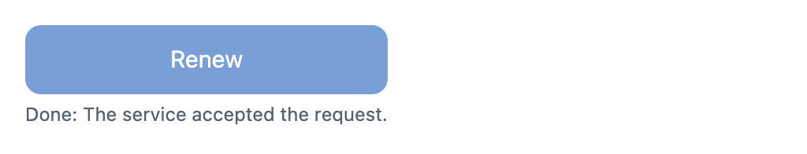
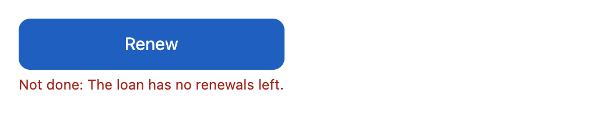
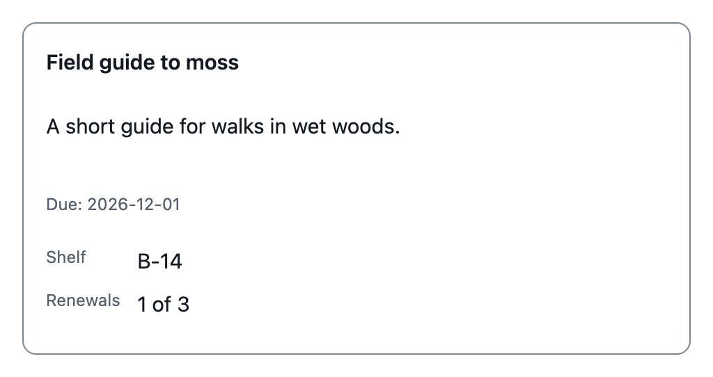
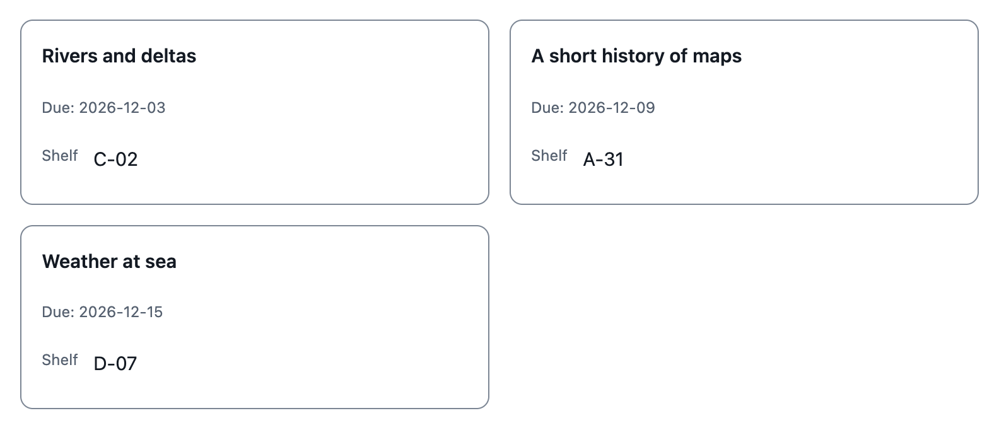
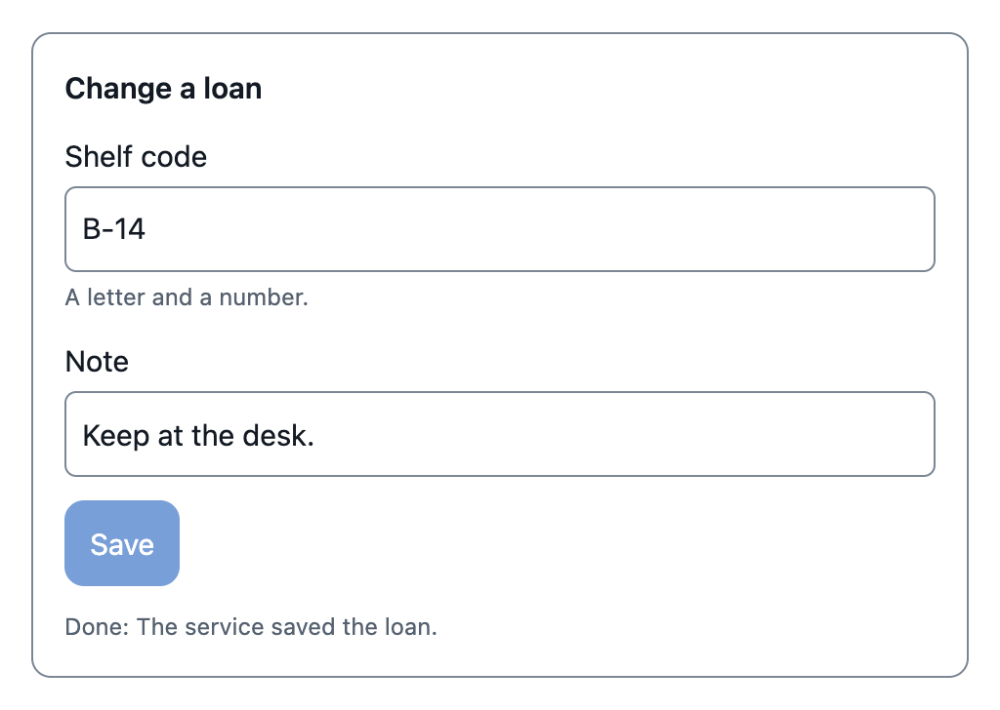

<picture>
  <source media="(prefers-color-scheme: dark)" srcset="docs/brand/logos/mugham-lockup-dark.svg">
  
</picture>

# mugham

Mugham is a UI toolkit for agentic applications. The name is the Tamil word for "face".

Agents and LLMs: read [CONSTITUTION.md](CONSTITUTION.md) and [AGENTS.md](AGENTS.md) first.

Status: release `v0.2.0` is the newest. It has the contract format 2, the design tokens, the primitives, the catalog components, the message envelope and the thread for people and agents. The offline mode is not built yet. The plan is in [docs/STATUS.md](docs/STATUS.md) and in the GitHub milestones.

## What it gives

- **A thread for people and agents.** Several people and several agents can be in one conversation. Each message names its actor.
- **Declared components.** Cards, action buttons, editable forms and card grids come from a component catalog. A model fills a declared component with data. It never sends markup or code.
- **Actions with receipts.** An action goes to the API of your application. The kit shows it as done only after the receipt comes back.
- **Each device.** The kit runs as a progressive web app. In offline mode, it keeps each action in a queue and shows it as pending.
- **Examples.** Synthetic examples show how to build a page from the catalog.
- **No dependencies.** The kit uses only web standards and has no third-party runtime dependency. It works with any web framework, or with none.

## Highlights

The images show the light theme. If your viewer uses the dark theme, the images show the dark theme.

**Actions with receipts.** The application binds the tool. A press shows `Pending`. The button shows `Done` or `Not done` only after the receipt of the API comes back.

| Pending | Done | Not done |
|---|---|---|
| <picture>  <source media="(prefers-color-scheme: dark)" srcset="docs/screenshots/action-button-pending-dark.png">  </picture> | <picture>  <source media="(prefers-color-scheme: dark)" srcset="docs/screenshots/action-button-done-dark.png">  </picture> | <picture>  <source media="(prefers-color-scheme: dark)" srcset="docs/screenshots/action-button-error-dark.png">  </picture> |

**Cards and card grids.** A model fills a card with data. It never sends markup or style.

<picture>
  <source media="(prefers-color-scheme: dark)" srcset="docs/screenshots/card-dark.png">
  
</picture>

<picture>
  <source media="(prefers-color-scheme: dark)" srcset="docs/screenshots/card-grid-dark.png">
  
</picture>

**Editable forms.** A person edits the values and saves them as one action. The form shows `Done` only after the receipt comes back.

<picture>
  <source media="(prefers-color-scheme: dark)" srcset="docs/screenshots/editable-form-done-dark.png">
  
</picture>

## Catalog

Each component has a contract file in [catalog/](catalog/README.md). The contract declares the data, the states and the accessibility rules. A model fills a component only with data that its contract accepts.

| Component | What it does | Contract |
|---|---|---|
| `mu-text` | Shows a run of text. It never shows the value as markup. | [text.json](catalog/text.json) |
| `mu-button` | Sends a press event to the code that contains it. | [button.json](catalog/button.json) |
| `mu-field` | A labeled text input, with a hint, an error and a disabled state. | [field.json](catalog/field.json) |
| `mu-stack` | Puts its child elements in one column or one row. | [stack.json](catalog/stack.json) |
| `mu-grid` | Puts its child elements in columns of equal width. | [grid.json](catalog/grid.json) |
| `mu-card` | Shows a title, a summary, a date and up to six facts. | [card.json](catalog/card.json) |
| fact | A label and a value in a card. It has no element of its own. | [fact.json](catalog/fact.json) |
| `mu-action-button` | A button for one action. It shows done only after the receipt comes back. | [action-button.json](catalog/action-button.json) |
| `mu-editable-form` | Up to 20 text fields. A person edits the values and submits them as one action. | [editable-form.json](catalog/editable-form.json) |
| `mu-card-grid` | A labeled list of cards in columns of equal width. | [card-grid.json](catalog/card-grid.json) |
| `mu-citation` | The source of a claim: a source name, a locator as text and an open button. | [citation.json](catalog/citation.json) |
| `mu-excerpt` | A passage of a source as text with a marked span, the source name, the locator as text and an open button. | [excerpt.json](catalog/excerpt.json) |

The first five components are primitives. The other components use them.

### Make the screenshots again

The images come from a fixture page with synthetic data, [tests/browser/gallery.html](tests/browser/gallery.html). The script uses Node.js and Chrome only. It writes the images to [docs/screenshots/](docs/screenshots/). The images are not in the package. The constitution allows 16 images maximum, so the images show only the highlights.

```sh
make screenshots
```

If Chrome is not at its usual path, set `CHROME` to the path of the Chrome executable.

## Quickstart

The examples are ES modules that import JSON files. A browser blocks module imports from a `file:` page. Thus the page needs an HTTP server. The kit has no dependency, so there is nothing to install.

1. Install Python 3 and Git. Use a browser from the [browser support](#browser-support) list.
2. Clone the repository and go to its root:

```sh
git clone https://github.com/mohanraj00/mugham.git
cd mugham
```

3. Start a static file server at the repository root:

```sh
python3 -m http.server 8000
```

   If port 8000 is in use, the command fails with an error. Choose a different port, for example `python3 -m http.server 8001`, and use that port in the next step.

4. Open an example in the browser. The examples use synthetic data. The URLs below use port 8000.
   - `http://localhost:8000/examples/primitives.html`: each primitive.
   - `http://localhost:8000/examples/loans.html`: a card, an action button, a card grid and a form.
   - `http://localhost:8000/examples/citation.html`: a citation in a message, a citation with no source and a refused citation.
   - `http://localhost:8000/examples/excerpt.html`: an excerpt of a synthetic document in a message, and a refused excerpt.
   - `http://localhost:8000/examples/provenance.html`: a card with the authorship slot and the citation slot, and a refused card.
   - `http://localhost:8000/examples/register.html`: an application contract and element for a synthetic seed tray, a refused fill, and the tray in a thread.

5. For the thread example, stop the static server and start the example server. It streams synthetic agent events as server-sent events and gives the receipt of each action:

```sh
python3 tools/thread_server.py
```

   The server prints the URL of the example. Open that URL. The default port is 8765. If that port is in use, the server takes a free port and prints its URL. To choose the port, use `python3 tools/thread_server.py --port 8766`. If a port that you chose is in use, the server prints one line that names the port and exits with an error. Then choose a different port. Two people and two agents talk about a loan. The thread refuses one undeclared component. The Renew action shows `Done` only after the receipt comes back.

To use the kit in your own page, serve `src/` and `catalog/` from one origin, load `src/tokens/tokens.css`, then import `define` from `src/components/index.js` and call it. [src/README.md](src/README.md) gives the steps.

Each release has the archive `mugham.tar` and its `mugham.tar.sha256` file as release assets. Two builds of the same source give the same bytes. The release publishes no package ([decision 0004](docs/decisions/0004-package.md)).

Run the project checks with `make check`. The checks need Python 3, Node.js and Chrome.

## Browser support

The kit imports JSON files with the syntax `import x from './x.json' with { type: 'json' }`. A browser must support this syntax. These are the minimum versions:

| Browser | Minimum version |
|---|---|
| Chrome and Edge | 123 |
| Safari | 17.2 |
| Firefox | 138 |

The checks of the project run in one pinned version of Chrome. They do not test the other browsers.

## Stability

The stability of the element API (the elements and their properties), the events (`mu-press`, `mu-edit`, `mu-action` and `mu-refused`) and contract format 2 is **experimental**, before v1.0. Each of them can change in a minor release. Format 1 changed in v0.2.0 ([mugham#35](https://github.com/mohanraj00/mugham/issues/35)). The [changelog](CHANGELOG.md) lists each change. v1.0 gives a compatibility statement.

## Brand

The logo files, the colors and the type rules are in [docs/brand/](docs/brand/README.md).

## Contribute

Read [CONTRIBUTING.md](CONTRIBUTING.md) and the [constitution](CONSTITUTION.md). Report a possible vulnerability as [SECURITY.md](SECURITY.md) says.

## License

Apache-2.0. See [LICENSE](LICENSE).
