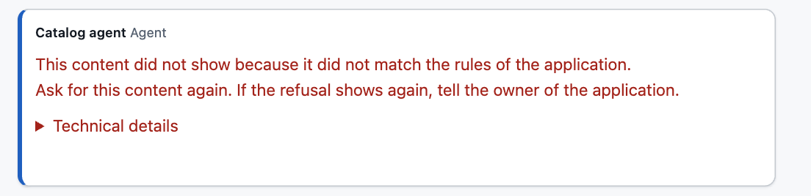

<picture>
  <source media="(prefers-color-scheme: dark)" srcset="docs/brand/logos/mugham-lockup-dark.svg">
  
</picture>

# mugham

Mugham is a UI toolkit for agentic applications. A coding agent, or a model at run time, builds the UI from declared components. The page keeps control:

- A model fills only declared components, with data that the contract accepts. It never sends markup, style or code.
- Each message names its actor: a person, an agent or the system.
- The page binds each tool in code. A fill never names a tool.
- An action shows `Done` only after the receipt of your API comes back.

Start with the [quickstart](#quickstart) or the [guides](docs/guides/README.md). The kit has no runtime dependency and no build step. The name is the Tamil word for "face".

Agents and LLMs: read [CONSTITUTION.md](CONSTITUTION.md) and [AGENTS.md](AGENTS.md) first.

The newest release is `v0.5.0`. It adds the offline mode with a queue of pending actions, an icon display for the action button and a compact density preset. It has contract format 2, the design tokens, the primitives, the catalog components, the message envelope and the thread for people and agents. It also has the evidence components, typed form edits, the chat controls, the data grid, rich text, the upload control, the offline data source interface, two examples on a fixture API, the helper functions, the short contract form, the default page style and one entry point for the examples. A reader of a local bundle, a cache or a database belongs to the application. [Offline queue contract](docs/contracts/offline-queue.md) gives the queue rules. [docs/STATUS.md](docs/STATUS.md) gives the release plan.

## Docs

The [guides](docs/guides/README.md) show how to build a page with the kit. A check runs the code of each guide.

- [Contracts](docs/guides/contracts.md): what a contract declares, how the kit refuses a fill, and how to register an application contract.
- [Assemble a page](docs/guides/assemble.md): a stack, a grid of cards, an action with a receipt and a thread.
- [Theme the kit](docs/guides/theme.md): each token, the two themes, forced colors, reduced motion and the parts a page must not change.
- [For coding agents](docs/guides/agents.md): the rules, the file to read for each task and a checklist.
- [Kit helpers](src/kit.md) for fills, actions and tool schemas.

## The thread

These four frames come from [examples/thread/thread.html](examples/thread/thread.html), in order. Two people and two agents talk about a synthetic library loan. If your viewer uses the dark theme, the images show the dark theme.

1. **People and agents.** Robin and Sam are people. The catalog agent answers and fills a declared card. Each message shows the name and the type of its actor, and each agent message has a mark at its left edge. The card shows `Author:` with the agent that filled it.

   <picture>
     <source media="(prefers-color-scheme: dark)" srcset="docs/screenshots/thread-1-people-and-agents-dark.png">
     
   </picture>

2. **A refused part.** The catalog agent sends a component with the name `banner`. No contract has this name, so the thread does not show the part. It shows the refusal as text.

   <picture>
     <source media="(prefers-color-scheme: dark)" srcset="docs/screenshots/thread-2-refused-dark.png">
     
   </picture>

3. **The action is pending.** The renewal agent proposes the Renew action. The page binds the tool `library.renew` in code. A person presses the button, and it shows `Pending` while the request goes to the API.

   <picture>
     <source media="(prefers-color-scheme: dark)" srcset="docs/screenshots/thread-3-pending-dark.png">
     
   </picture>

4. **The action is done.** The receipt of the API comes back. Only then does the button show `Done`, with the message and the reference of the receipt.

   <picture>
     <source media="(prefers-color-scheme: dark)" srcset="docs/screenshots/thread-4-done-dark.png">
     
   </picture>

`make screenshots` makes these images again from the example and its synthetic data. It uses Node.js, Python 3 and Chrome. If Chrome is not at its usual path, set `CHROME` to the path of the Chrome executable. The images are not in the package.

## Build a UI with a coding agent

Give the agent the task and the guide. For example:

```text
Build a page with the mugham kit that <your task>.
Read docs/guides/agents.md first and obey each rule.
Use only components that have a contract in catalog/ or a contract that you register.
Bind each tool in code. Show Done only after the receipt of the API.
Verify the page with the checklist of the guide.
```

The guide [docs/guides/agents.md](docs/guides/agents.md) gives the rules, the file to read for each task and a checklist. The other [guides](docs/guides/README.md) give the code of each step.

Run these checks:

1. Verify the page with each item of the [checklist](docs/guides/agents.md#checklist).
2. Load the page in a browser. Make sure that no element shows `Refused`, except for each fill that you planned to refuse.
3. If the agent changes this repository, run `make check`. The checks need Python 3, Node.js and Chrome.

## What it gives

- **A thread for people and agents.** Several people and several agents can be in one conversation. Each message names its actor.
- **Declared components.** Cards, action buttons, editable forms and card grids come from a component catalog. A model fills a declared component with data. It never sends markup or code.
- **Actions with receipts.** An action goes to the API of your application. The kit shows it as done only after the receipt comes back.
- **Examples.** Synthetic examples show how to build a page from the catalog.
- **No dependencies.** The kit uses only web standards and has no third-party runtime dependency. It works with any web framework, or with none.

## Catalog

Each component has a contract file in [catalog/](catalog/README.md). The contract declares the data, the states and the accessibility rules. A model fills a component only with data that its contract accepts.

| Component | What it does | Contract |
|---|---|---|
| `mu-text` | Shows a run of text. It never shows the value as markup. | [text.json](catalog/text.json) |
| `mu-button` | Sends a press event to the code that contains it. | [button.json](catalog/button.json) |
| `mu-field` | A labeled text input, with a hint, an error and a disabled state. | [field.json](catalog/field.json) |
| `mu-long-text-field` | A labeled text area for text of more than one line. | [long-text-field.json](catalog/long-text-field.json) |
| `mu-number-field` | A labeled input for a number, with an optional range. | [number-field.json](catalog/number-field.json) |
| `mu-range-field` | Shows one or two sliders, with a number box for each handle. | [range-field.json](catalog/range-field.json) |
| `mu-select-field` | Shows one choice and adds search for long lists. | [select-field.json](catalog/select-field.json) |
| `mu-multi-choice-field` | Shows checkboxes for short lists and a searchable tag picker for long lists. | [multi-choice-field.json](catalog/multi-choice-field.json) |
| `mu-date-field` | A labeled input for a date as `YYYY-MM-DD`, with an optional range. | [date-field.json](catalog/date-field.json) |
| `mu-date-range-field` | Two native date inputs for an ordered pair of dates. | [date-range-field.json](catalog/date-range-field.json) |
| `mu-time-field` | A native time input with optional limits and a step in minutes. | [time-field.json](catalog/time-field.json) |
| `mu-date-time-field` | A native input for a local date and time, with a fixed time zone label. | [date-time-field.json](catalog/date-time-field.json) |
| `mu-choice-field` | A labeled radio group with 1 to 20 choices. | [choice-field.json](catalog/choice-field.json) |
| `mu-stack` | Puts its child elements in one column or one row. | [stack.json](catalog/stack.json) |
| `mu-grid` | Puts its child elements in columns of equal width. | [grid.json](catalog/grid.json) |
| `mu-card` | Shows a title, a summary, a date and up to six facts. | [card.json](catalog/card.json) |
| fact | A label and a value in a card. It has no element of its own. | [fact.json](catalog/fact.json) |
| `mu-action-button` | A button for one action. It shows done only after the receipt comes back. | [action-button.json](catalog/action-button.json) |
| `mu-dialog` | A centered modal with a title, a close button and content from the page. | [dialog.json](catalog/dialog.json) |
| `mu-drawer` | A modal at the inline end, or at the bottom on a narrow screen. | [drawer.json](catalog/drawer.json) |
| `mu-menu` | A button that opens a list of named choices for the page. | [menu.json](catalog/menu.json) |
| `mu-tooltip` | Text that describes a control on hover or focus. | [tooltip.json](catalog/tooltip.json) |
| `mu-toast` | A live status message with an optional close button. | [toast.json](catalog/toast.json) |
| `mu-tabs` | Selects one panel of page content from a list of named tabs. | [tabs.json](catalog/tabs.json) |
| `mu-accordion` | Opens and closes independent sections of page content. | [accordion.json](catalog/accordion.json) |
| `mu-app-shell` | A top bar, a main area and a side bar that opens in a drawer on a phone. | [app-shell.json](catalog/app-shell.json) |
| `mu-breadcrumbs` | Links in page order, with a mark for the current page. | [breadcrumbs.json](catalog/breadcrumbs.json) |
| `mu-pagination` | Numbered controls that request a page of content. | [pagination.json](catalog/pagination.json) |
| `mu-steps` | An ordered list that shows the position and state of each wizard step. | [steps.json](catalog/steps.json) |
| `mu-run-steps` | An ordered list of agent run steps with states and optional tool details. | [run-steps.json](catalog/run-steps.json) |
| `mu-plan` | A list of agent tasks with their states. | [plan.json](catalog/plan.json) |
| `mu-approval-queue` | A list of agent proposals with a state mark, a confirm step and a receipt for each decision. | [approval-queue.json](catalog/approval-queue.json) |
| `mu-progress` | A named bar with a known or unknown value. | [progress.json](catalog/progress.json) |
| `mu-empty-state` | A heading and short text for an empty result, with a slot for a page control. | [empty-state.json](catalog/empty-state.json) |
| `mu-skeleton` | A named loading status with lines that hold space for content. | [skeleton.json](catalog/skeleton.json) |
| `mu-badge` | A short label with a tone. | [badge.json](catalog/badge.json) |
| `mu-avatar` | A name shown as initials. | [avatar.json](catalog/avatar.json) |
| `mu-editable-form` | Up to 20 kit or registered fields. A person edits the values and submits them as one action. | [editable-form.json](catalog/editable-form.json) |
| `mu-form-card` | A long form in sections, as labels and values. A person edits one field in place and sends the changes as one action. Some fields are read-only. | [form-card.json](catalog/form-card.json) |
| `mu-card-grid` | A labeled list of cards in columns of equal width. | [card-grid.json](catalog/card-grid.json) |
| `mu-citation` | The source of a claim: a source name, a locator as text and an open button. | [citation.json](catalog/citation.json) |
| `mu-diff` | The difference between two versions of a text or a list of fields. Each change shows as added, removed, changed or unchanged in words. A person opens and closes each part. | [diff.json](catalog/diff.json) |
| `mu-excerpt` | A passage of a source as text with a marked span, the source name, the locator as text and an open button. | [excerpt.json](catalog/excerpt.json) |
| `mu-table` | A table of text with column headers, rows, optional row status text, keyboard sorting and an empty state. | [table.json](catalog/table.json) |
| `mu-status` | One state as text: pending, passed, failed or unknown, with a border style for each state. The application or the service gives the state. | [status.json](catalog/status.json) |
| `mu-image` | An image in a fixed box with a caption and a text alternative. Page code permits the origins. A native dialog shows the full-size view. | [image.json](catalog/image.json) |
| `mu-chart` | An SVG bar, line or stacked bar chart with keyboard point controls and a table view. | [chart.json](catalog/chart.json) |
| `mu-rich-text` | Paragraphs, headings, lists, code blocks and quotes with an optional approval mark on each block. | [rich-text.json](catalog/rich-text.json) |
| `mu-data-grid` | An editable grid with column headers, row headers and typed cells. Each saved change goes to the application as one action, and the cell shows a marker until the receipt comes back. | [data-grid.json](catalog/data-grid.json) |
| `mu-upload` | A control that takes files with a file picker or a drop. Page code binds the tool, the accepted types, the size limit and the file count. Done shows only after the receipt. | [upload.json](catalog/upload.json) |
| `mu-source-status` | The state of an offline data source as text: ready, stale, empty or error, with the time of the last confirmed read. The application fills it, not a model. | [source-status.json](catalog/source-status.json) |
| `mu-action-queue` | The actions of the offline queue, each with its state as text and its exits: retry, cancel or dismiss. A waiting action shows as pending, never as done. The application fills it, not a model. | [action-queue.json](catalog/action-queue.json) |

The first five components are primitives. The other components use them.

## Quickstart

Serve `src/` and `catalog/` over HTTP. Use this HTML to show a card with an action. The function in this example acts as a synthetic API. In an application, return the receipt of your API.

```html
<link rel="stylesheet" href="/src/tokens/tokens.css">
<main></main>
<script type="module">
import { define } from '/src/components/index.js';
import { mount, onAction } from '/src/kit.js';
define();
const card = mount('card', { title: 'Field guide to moss' }, { actor: { type: 'agent', id: 'loan-helper' }, parent: document.querySelector('main') });
onAction(card, (tool) => ({ ok: tool === 'loan.renew', message: 'The service processed the request.' }));
mount('action-button', { label: 'Renew' }, { parent: card, slot: 'actions', action: { tool: 'loan.renew', label: 'Renew' } });
</script>
```

### Run the examples

The examples are ES modules that import JSON files. A browser blocks module imports from a `file:` page. Thus the page needs an HTTP server. The kit has no dependency, so there is nothing to install.

1. Install Python 3 and Git. Use a browser from the [browser support](#browser-support) list.
2. Clone the repository and go to its root:

```sh
git clone https://github.com/mohanraj00/mugham.git
cd mugham
```

3. Start the file server of the examples at the repository root:

```sh
python3 tools/serve.py
```

   The server prints the URL of the index page of the examples. It listens on `127.0.0.1` only and gives the files of `src/`, `catalog/` and `examples/` only. The default port is 8000. If that port is in use, the server takes a free port and prints its URL. Use that port in the next step. To choose the port, use `python3 tools/serve.py --port 8001`.

4. Open the index page of the examples in the browser: `http://localhost:8000/examples/`. The index lists each example in groups: cards and actions, inputs and forms, tables and grids, evidence, chat thread, media, apps and guides. Type a word to filter the list. Each example page has a link back to the index, and links to the previous example and the next example. Some examples read a fixture API, and this server does not have it. The index and the page of such an example give the command that starts its API. Each example page also has a docs panel next to the live example. The panel gives the element name, the keys of the contract with their types, the events, the actions and a sample fill of each component on the page. On a narrow screen, the panel is below the example. The examples use synthetic data. The URLs below use port 8000. The index links each of these pages:
   - `http://localhost:8000/examples/cards/primitives.html`: each primitive.
   - `http://localhost:8000/examples/cards/loans.html`: a card, an action button, a card grid and a form.
   - `http://localhost:8000/examples/cards/dialogs.html`: a seed tray reservation with a confirm step and a drawer with tray details.
   - `http://localhost:8000/examples/cards/settings.html`: settings in tabs and an accordion, with a confirm step and a toast after a save.
   - `http://localhost:8000/examples/apps/research.html`: an agent run and a plan for a library catalog search.
   - `http://localhost:8000/examples/apps/newsletter.html`: three newsletter blocks with approval states from a fixture API.
   - `http://localhost:8000/examples/apps/library.html`: a library staff page with a side bar, breadcrumbs, a list with numbered pages and a wizard to add a member.
   - `http://localhost:8000/examples/cards/popovers.html`: tray choices, help text and a message after a note save.
   - `http://localhost:8000/examples/cards/approval-icons.html`: a request card with buttons to approve or reject the request.
   - `http://localhost:8000/examples/forms/inputs.html`: a form with text, long text, a number, a date and a choice.
   - `http://localhost:8000/examples/forms/branches.html`: a form with a search box for 40 synthetic library branches.
   - `http://localhost:8000/examples/forms/garden.html`: a form with sun level checkboxes and a tag picker for 30 synthetic plants.
   - `http://localhost:8000/examples/forms/notices.html`: a library notice form with two switches.
   - `http://localhost:8000/examples/forms/ranges.html`: sliders for a loan period and a synthetic price range.
   - `http://localhost:8000/examples/forms/booking.html`: a room booking with a date range, a start time and a setup date and time.
   - `http://localhost:8000/examples/forms/colors.html`: a form with a registered field for a label color.
   - `http://localhost:8000/examples/forms/contact.html`: a registered contact card with two kit fields and a save button.
   - `http://localhost:8000/examples/forms/membership.html`: a form card with 3 sections and 25 fields in a thread, with read-only fields that the service computes.
   - `http://localhost:8000/examples/evidence/citation.html`: a citation in a message, a citation with no source and a refused citation.
   - `http://localhost:8000/examples/evidence/diff.html`: a diff of two versions of a synthetic hall booking, and a large diff that starts closed.
   - `http://localhost:8000/examples/thread/rich-text.html`: an agent message with rich text in a thread, markup that shows as text and a refused script address.
   - `http://localhost:8000/examples/tables/budget.html`: an editable grid with a synthetic budget, a total row that the page computes and a refused amount.
   - `http://localhost:8000/examples/tables/density.html`: a card grid and a data grid in the default and compact densities.
   - `http://localhost:8000/examples/evidence/excerpt.html`: an excerpt of a synthetic document in a message, and a refused excerpt.
   - `http://localhost:8000/examples/evidence/provenance.html`: a card with the authorship slot and the citation slot, and a refused card.
   - `http://localhost:8000/examples/tables/table.html`: a table of synthetic plots with keyboard sorting and an empty table.
   - `http://localhost:8000/examples/cards/status.html`: each state of the status component, and a refused state.
   - `http://localhost:8000/examples/media/chart.html`: a bar chart, a line chart and a stacked bar chart of synthetic counts, each with a table view.
   - `http://localhost:8000/examples/media/image.html`: a synthetic floor plan in a message and in a card, and a refused image.
   - `http://localhost:8000/examples/evidence/narration.html`: a check that compares the narration of an agent with the values of a card.
   - `http://localhost:8000/examples/cards/offline.html`: an offline data source of a synthetic tool library in each state, offline and online.
   - `http://localhost:8000/examples/tables/snapshots.html`: versioned records on a fixture API. The page lists collections and snapshots, compares two snapshots with a diff and lists the records that the change affects. It only reads.
   - `http://localhost:8000/examples/cards/register.html`: an application contract and element for a synthetic seed tray, a refused fill, and the tray in a thread.
   - `http://localhost:8000/examples/tables/review-queue.html`: a review queue on a fixture API. A reviewer accepts, corrects or rejects an extracted value next to its source excerpt, and the page shows Done only after the receipt.

5. For the thread example, stop the static server and start the example server. It streams synthetic agent events as server-sent events and gives the receipt of each action:

```sh
python3 tools/thread_server.py
```

   The server prints the URL of the example. Open that URL. The default port is 8765. If that port is in use, the server takes a free port and prints its URL. To choose the port, use `python3 tools/thread_server.py --port 8766`. If a port that you chose is in use, the server prints one line that names the port and exits with an error. Then choose a different port. Two people and two agents talk about a loan. The loan card uses the short author line. The rules card shows a different author in full. The thread refuses one undeclared component. The Renew action shows `Done` only after the receipt comes back.

6. For the example apps, start the fixture API of the apps. It prints the URL of each app. The default port is 8770. If that port is in use, the server takes a free port.

```sh
python3 tools/apps_server.py
```

   - `http://127.0.0.1:8770/examples/apps/support/`: a support desk. A person opens a ticket, corrects the reply that an agent drafts, and sends it.
   - `http://127.0.0.1:8770/examples/apps/changes/`: a change review. An agent proposes a timetable change with a citation and source excerpts. A reviewer approves it with a confirm step and gets a receipt reference.
   - `http://127.0.0.1:8770/examples/apps/inspection/`: a field inspection for a phone. A registered checklist component, a findings form and a close action with a confirm step.

7. For the upload example, start its fixture API. It prints the URL of the example. The default port is 8767. The API keeps each file in memory only, and it decides each file again.

```sh
python3 tools/upload_server.py
```

   A person attaches synthetic PDF receipts to a ticket. The control refuses a file of a wrong type before a request, and each file shows `Done` only after the receipt of the API.

8. For the approval example, start its fixture API. It prints the URL of the example. The default port is 8766.

```sh
python3 -B tools/approval_server.py
```

   A person approves or rejects synthetic decisions as cards with their evidence. The API decides, and each button shows `Done` only after the receipt.

9. For the offline queue example, start its fixture API. It prints the URL of the example. The default port is 8769.

```sh
python3 -B tools/queue_server.py
```

   A person reserves a synthetic tool. Go offline with the button of the page, reserve a tool, then go online. The action shows `Pending` while it waits in the queue, and `Done` only after the receipt. The service worker of the page keeps its files, so the page loads offline.

To use the kit in your own page, serve `src/` and `catalog/` from one origin, load `src/tokens/tokens.css`, then import `define` from `src/components/index.js` and call it. [src/README.md](src/README.md) gives the steps. For a page style with no CSS of your own, also load `src/styles/page.css`. [Theme the kit](docs/guides/theme.md#the-default-page-style) gives its rules.

Each release has the archive `mugham.tar` and its `mugham.tar.sha256` file as release assets. Two builds of the same source give the same bytes. The release publishes no package ([decision 0004](docs/decisions/0004-package.md)).

Run the project checks with `make check`. The checks need Python 3, Node.js and Chrome.

The browser check also runs the long thread bench. [Long thread bench](src/thread/README.md#long-thread-bench) gives the command, the 16 ms target and the 16 ms CI margin.

## Limits

### Server side rendering

The kit renders each component in the browser when its JavaScript runs. The kit does not support server side rendering or declarative shadow DOM. [Decision 0003](docs/decisions/0003-shadow-dom.md#effects)

### Browser support

The kit uses plain JavaScript modules. You can serve them with no build step. The browser loads the catalog with JSON import attributes, so it must support `import x from './x.json' with { type: 'json' }`. [Decision 0001](docs/decisions/0001-build-tools.md)

Use one of these browser versions or a later version.

| Browser | Minimum version |
|---|---|
| Chrome and Edge | 123 |
| Safari | 17.2 |
| Firefox | 138 |

The checks of the project run in one pinned version of Chrome. They do not test the other browsers.

## Stability

The stability of the element API (the elements and their properties), the events (`mu-press`, `mu-edit`, `mu-action` and `mu-refused`) and contract format 2 is **experimental**, before v1.0. Each of them can change in a minor release. Format 1 changed in v0.2.0 ([mugham#35](https://github.com/mohanraj00/mugham/issues/35)). The [changelog](CHANGELOG.md) lists each change. v1.0 gives a compatibility statement.

## Brand

The logo files, the colors and the type rules are in [docs/brand/](docs/brand/README.md).

## Contribute

Read [CONTRIBUTING.md](CONTRIBUTING.md) and the [constitution](CONSTITUTION.md). Report a possible vulnerability as [SECURITY.md](SECURITY.md) says.

## License

Apache-2.0. See [LICENSE](LICENSE).
