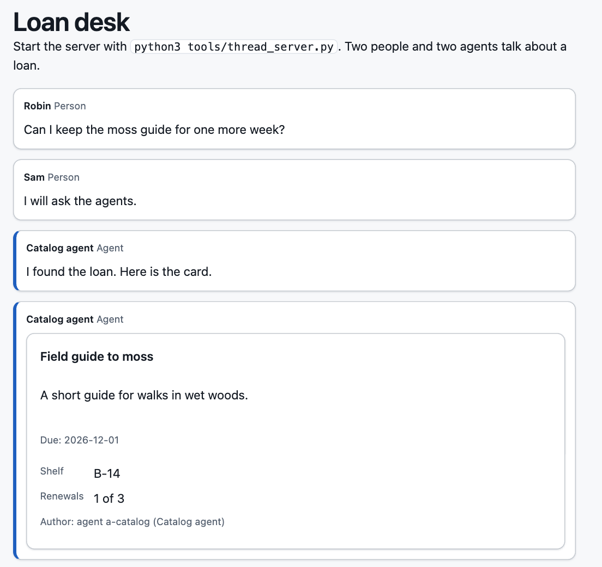
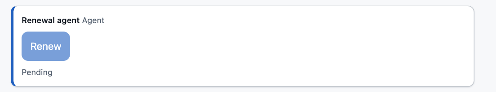
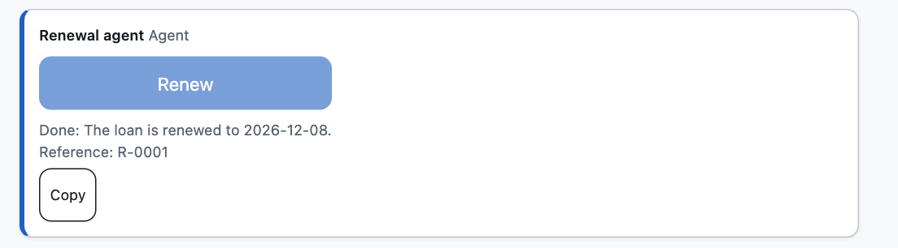

<picture>
  <source media="(prefers-color-scheme: dark)" srcset="docs/brand/logos/mugham-lockup-dark.svg">
  
</picture>

# mugham

Release: v0.9.0

Mugham is a UI toolkit for agentic applications: a chat thread for people and agents, cards, action buttons, editable forms and card grids. Developers build the screens of an application from its component catalog, and agents fill the components with data. The page keeps control:

- A model fills only declared components, with data that the contract accepts. It never sends markup, style or code.
- Each message names its actor: a person, an agent or the system.
- The page binds each tool in code. A fill never names a tool.
- An action shows `Done` only after the receipt of your API comes back.

The kit has no runtime dependency and no build step. The name is the Tamil word for "face". Agents and LLMs: read [CONSTITUTION.md](CONSTITUTION.md) and [AGENTS.md](AGENTS.md) first.

## Quickstart

You need Git, Python 3 and a browser from the [browser support](#browser-support) list. There is nothing to install.

1. Clone the repository and go to its root:

```sh
git clone https://github.com/mohanraj00/mugham.git
cd mugham
```

2. Start the file server of the examples:

```sh
python3 tools/serve.py
```

   The server prints `http://127.0.0.1:8000/examples/`. It listens on `127.0.0.1` only and gives only the files of `src/`, `catalog/` and `examples/`. If port 8000 is in use, it takes a free port and prints that URL. To choose the port, use `python3 tools/serve.py --port 8001`.

3. Open `http://localhost:8000/examples/` in the browser. The index lists each example in groups. Each example page has a docs panel with the element name, the contract keys, the events, the actions and a sample fill.

4. Make your first page. Save this HTML as `examples/hello.html`, then open `http://localhost:8000/examples/hello.html`. The function in `onAction` acts as a synthetic API. In an application, return the receipt of your API.

```html
<link rel="stylesheet" href="/src/tokens/tokens.css">
<main></main>
<script type="module">
import { define } from '/src/components/index.js';
import { mount, onAction } from '/src/kit.js';
define();
const card = mount('card', { title: 'Field guide to moss' }, { actor: { type: 'agent', id: 'loan-helper' }, parent: document.querySelector('main') });
onAction(card, (tool) => ({ ok: tool === 'loan.renew', message: 'The service processed the request.' }));
mount('action-button', { label: 'Renew' }, { parent: card, slot: 'actions', action: { tool: 'loan.renew', label: 'Renew' } });
</script>
```

   Expected result: the card `Field guide to moss` shows `Author: agent, loan-helper` and a `Renew` button. Press `Renew`. The button shows `Done: The service processed the request.` Remove `examples/hello.html` before you run `make check`, because the check lists each example page.

To use the kit in your own application, serve `src/` and `catalog/` from the origin of your page, with the same steps.

## Docs

The [guides](docs/guides/README.md) show how to build a page. A check runs the code of each guide.

- [Contracts](docs/guides/contracts.md): what a contract declares, how the kit refuses a fill, and how to register an application contract.
- [Assemble a page](docs/guides/assemble.md): a stack, a grid of cards, an action with a receipt and a thread.
- [Theme the kit](docs/guides/theme.md): each token, the two themes, forced colors, reduced motion and the parts a page must not change.
- [For coding agents](docs/guides/agents.md): the rules, the file to read for each task and a checklist.
- [Operations](docs/guides/README.md#operations): one short page for each public operation, with its API call, an example and its errors.
- [Catalog](catalog/README.md): each component and its contract.
- [Kit helpers](src/kit.md) for fills, actions and tool schemas.
- [Changelog](CHANGELOG.md) and [status](docs/STATUS.md): the changes of each release and the release plan.

## The thread

These four frames come from [examples/thread/thread.html](examples/thread/thread.html), in order. Two people and two agents talk about a synthetic library loan. If your viewer uses the dark theme, the images show the dark theme.

1. **People and agents.** Robin and Sam are people. The catalog agent answers and fills a declared card. Each message shows the name and the type of its actor, and each agent message has a mark at its left edge. The card shows `Author:` with the agent that filled it.

   <picture>
     <source media="(prefers-color-scheme: dark)" srcset="docs/screenshots/thread-1-people-and-agents-dark.png">
     
   </picture>

2. **A refused part.** The catalog agent sends a component with the name `banner`. No contract has this name, so the thread does not show the part. It shows the refusal as text.

   <picture>
     <source media="(prefers-color-scheme: dark)" srcset="docs/screenshots/thread-2-refused-dark.png">
     
   </picture>

3. **The action is pending.** The renewal agent proposes the Renew action. The page binds the tool `library.renew` in code. A person presses the button, and it shows `Pending` while the request goes to the API.

   <picture>
     <source media="(prefers-color-scheme: dark)" srcset="docs/screenshots/thread-3-pending-dark.png">
     
   </picture>

4. **The action is done.** The receipt of the API comes back. Only then does the button show `Done`, with the message and the reference of the receipt.

   <picture>
     <source media="(prefers-color-scheme: dark)" srcset="docs/screenshots/thread-4-done-dark.png">
     
   </picture>

`make screenshots` makes these images again from the example and its synthetic data. It uses Node.js, Python 3 and Chrome. If Chrome is not at its usual path, set `CHROME` to the path of the Chrome executable. The images are not in the package.

## Build a UI with a coding agent

Give the agent the task and the guide. For example:

```text
Build a page with the mugham kit that <your task>.
Read docs/guides/agents.md first and obey each rule.
Use only components that have a contract in catalog/ or a contract that you register.
Bind each tool in code. Show Done only after the receipt of the API.
Verify the page with the checklist of the guide.
```

The guide [docs/guides/agents.md](docs/guides/agents.md) gives the rules, the file to read for each task and a checklist. Then do these checks:

1. Verify the page with each item of the [checklist](docs/guides/agents.md#checklist).
2. Load the page in a browser. Make sure that no element shows `Refused`, except for each fill that you planned to refuse.
3. If the agent changes this repository, run `make check`. The checks need Python 3, Node.js and Chrome.

## Examples

All examples use synthetic data. With `python3 tools/serve.py`, open these pages below `http://localhost:8000/`:

- Cards and actions: [loans](examples/cards/loans.html), [primitives](examples/cards/primitives.html), [approval icons](examples/cards/approval-icons.html), [application contract](examples/cards/register.html), [offline source](examples/cards/offline.html), [service status](examples/cards/service-status.html), [dialog and drawer](examples/cards/dialogs.html), [menu, tooltip and toast](examples/cards/popovers.html), [settings](examples/cards/settings.html), [status](examples/cards/status.html).
- Inputs and forms: [input types](examples/forms/inputs.html), [notices](examples/forms/notices.html), [ranges](examples/forms/ranges.html), [branches](examples/forms/branches.html), [garden bed](examples/forms/garden.html), [booking](examples/forms/booking.html), [label color](examples/forms/colors.html), [contact card](examples/forms/contact.html), [membership form](examples/forms/membership.html).
- Tables and grids: [table](examples/tables/table.html), [data grid](examples/tables/budget.html), [density](examples/tables/density.html), [review queue](examples/tables/review-queue.html), [snapshots](examples/tables/snapshots.html).
- Evidence: [citation](examples/evidence/citation.html), [excerpt](examples/evidence/excerpt.html), [provenance](examples/evidence/provenance.html), [diff](examples/evidence/diff.html), [narration check](examples/evidence/narration.html).
- Thread and media: [rich text](examples/thread/rich-text.html), [run steps](examples/thread/run-steps.html), [image](examples/media/image.html), [charts](examples/media/chart.html).
- Apps: [library staff](examples/apps/library.html), [research](examples/apps/research.html), [note editor](examples/apps/library-note.html), [newsletter](examples/apps/newsletter.html), [town services](examples/apps/services.html).

Some examples need a fixture API. Run the command, and open the URL that the command prints. If the default port is in use, the server takes a free port.

| Example | Command | Default port |
|---|---|---|
| Thread | `python3 tools/thread_server.py` | 8765 |
| Approvals | `python3 -B tools/approval_server.py` | 8766 |
| Upload | `python3 tools/upload_server.py` | 8767 |
| Offline queue | `python3 -B tools/queue_server.py` | 8769 |
| Support desk, change review and field inspection apps | `python3 tools/apps_server.py` | 8770 |

## Build and checks

Each release has the archive `mugham.tar` and its `mugham.tar.sha256` file as release assets. Two builds of the same source give the same bytes. The release publishes no package ([decision 0004](docs/decisions/0004-package.md)).

Run the project checks with `make check`. The checks need Python 3, Node.js and Chrome. The browser check also runs the [long thread bench](src/thread/README.md#long-thread-bench).

## Limits

The kit renders each component in the browser when its JavaScript runs. It does not support server side rendering or declarative shadow DOM ([decision 0003](docs/decisions/0003-shadow-dom.md#effects)).

### Browser support

The browser loads the catalog with JSON import attributes, so it must support `import x from './x.json' with { type: 'json' }` ([decision 0001](docs/decisions/0001-build-tools.md)). Use one of these browser versions or a later version.

| Browser | Minimum version |
|---|---|
| Chrome and Edge | 123 |
| Safari | 17.2 |
| Firefox | 138 |

The checks of the project run in one pinned version of Chrome. They do not test the other browsers.

## Stability

Before v1.0, the element API, the events (`mu-press`, `mu-edit`, `mu-action` and `mu-refused`) and contract format 2 are **experimental**. Each of them can change in a minor release. The [changelog](CHANGELOG.md) lists each change. v1.0 gives a compatibility statement.

## Brand, contributions and license

The logo files, the colors and the type rules are in [docs/brand/](docs/brand/README.md). Read [CONTRIBUTING.md](CONTRIBUTING.md) and the [constitution](CONSTITUTION.md) before you contribute. Report a possible vulnerability as [SECURITY.md](SECURITY.md) says. The license is Apache-2.0. See [LICENSE](LICENSE).
